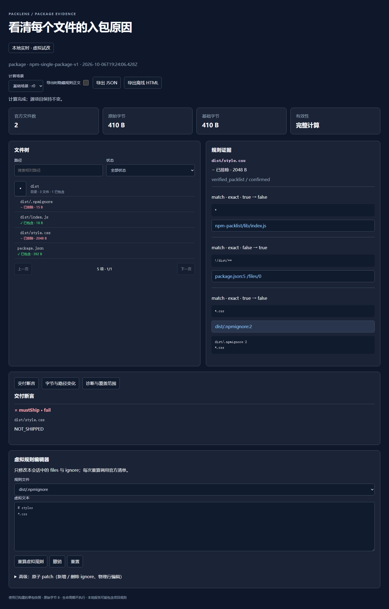

# PackLens

[简体中文](README_ZH.md)

**Explain npm package contents locally, trace rule evidence, try virtual edits, and check shipping assertions and raw-byte budgets.**

PackLens 是本地 npm 入包原因解释器，核对官方清单，展示规则证据，支持虚拟试改、交付断言与原始字节预算。

## Find the missing CSS

The synthetic CSS demo contains a 2,048 B stylesheet excluded by `dist/.npmignore:2`. Remove `*.css` in the virtual editor and calculate again:

| Computed scene | `dist/style.css` | `mustShip` | Total raw bytes |
| --- | --- | --- | --- |
| Baseline | Excluded | Fail | 410 B |
| Remove physical line 2 | Included | Pass | 2,458 B |

The net increase is exactly 2,048 B. A `files` edit can also change the bytes of retained `package.json`; PackLens shows that separately.



## Build and try it

Use **Node 24.15.0**. Install development dependencies, build, and generate a complete offline comparison:

```sh
npm ci --ignore-scripts
npm run build
node dist/cli.js demo css-missing --html ../css-demo.html
node dist/cli.js serve fixtures/css-missing/package --intent fixtures/css-missing/intent.json
```

Open the credential-free `http://127.0.0.1:<port>/` printed by `serve`. Select `dist/.npmignore`, remove `*.css`, and choose **Recalculate virtual rules**. Undo, reset, atomic patch input, and export work within that session. The default interface is Chinese; add `--locale en` for English. The source package stays unchanged.

The saved HTML opens directly from disk and switches complete, already computed scenes. It provides search, status filters, collapsible directories, evidence locations, assertions, and exact deltas. Live Node computation supports new experiments. All assets and fonts are local.

To install a local distributable without development tools:

```sh
npm pack --ignore-scripts
# From a separate directory:
npm install --omit=dev --ignore-scripts /path/to/packlens-0.1.0.tgz
./node_modules/.bin/packlens demo css-missing --html css-demo.html
```

On Windows use `node_modules\.bin\packlens.cmd`. The tarball bundles six controlled demo assets and explicit exact pins for the profile dependencies. This repository currently provides source/local tarball distribution.

## Commands

```sh
node dist/cli.js analyze ./your-built-package --intent ./intent.json --json
node dist/cli.js analyze ./your-built-package --html ../report.html
node dist/cli.js explain ./your-built-package dist/style.css
node dist/cli.js simulate ./your-built-package --patch ./patch.json --intent ./intent.json --html ../comparison.html
node dist/cli.js serve ./your-built-package --intent ./intent.json --port 0
node dist/cli.js demo nested-ignore --html ../nested.html
node dist/cli.js --version
```

Report outputs must be outside the analyzed root. Existing files require `--overwrite`. `--output-json <path>` saves the public JSON projection. `--strict-explanations` requires covered file explanations; `--locale zh-CN|en` selects language. `serve --open` uses the Windows default browser; other platforms return `OPEN_UNSUPPORTED` for that optional flag.

Exit codes are `0` complete/pass, `1` definite assertion failure, `2` unknown/uncovered/stale/limit or strict explanation failure, and `3` invalid input or execution error. Priority is `3 > 2 > 1 > 0`. The `forced-include` demo intentionally returns `1` after its patch because forced files still ship.

## Shipping intent and edits

```json
{"schemaVersion":1,"mustShip":["dist/style.css","templates/**/*.html"],"mustNotShip":["tests/**"],"sizeBudget":{"maxRawBytes":"1048576"}}
```

`mustShip` requires every existing match to ship and fails on zero matches. `mustNotShip` requires zero shipped matches. Budgets use exact integer raw bytes; equality passes. Intent selectors support literal paths, `*`, `**`, and `?`; they have a separate defined matcher from npm's `files` semantics.

```json
{"schemaVersion":1,"operations":[{"op":"removeIgnoreLine","path":"dist/.npmignore","line":2,"expected":"*.css"}]}
```

Supported operations: `replaceFiles`, `removeIgnoreLine`, `replaceIgnoreLine`, `appendIgnoreLine`, `replaceIgnoreText`, `createIgnore`, and `deleteIgnore`. A batch edits physical lines atomically against one revision. The editor also accepts complete patch JSON. Each committed scene uses the official library and monotonically increasing revision; unsuccessful computations retain the last valid scene.

## Six reproducible demos

| Name | Demonstrated result |
| --- | --- |
| `nested-ignore` | Child rule repair stays local; blocked descendants retain ancestor evidence |
| `empty-glob` | Fix `distt/**`; existing files ship and the zero-match warning disappears |
| `css-missing` | Remove physical line 2; the 2,048 B stylesheet ships |
| `template-missing` | Add `templates` to `files`; root ignore remains inactive |
| `unexpected-growth` | Restore `files: ["dist"]`; unwanted drafts/tests disappear and the 408 B budget boundary passes |
| `forced-include` | Metadata and declared main/bin stay included even after ineffective ignore removal |

Each [fixture](fixtures/) has a real package, intent, patch, fixed expected lists and copyable commands. Tests compare baseline and physically patched packages against shadow official packlist, traced walker, physical official packlist, and npm 12.2.0 CLI. Lifecycle sentinels establish that scripts stay unexecuted.

## API

```js
import { snapshotPackage, createScenarioSession, renderHtml, toPublicReport } from 'packlens';
const session = await createScenarioSession(await snapshotPackage('./your-built-package'), {
  schemaVersion: 1, mustShip: ['dist/style.css']
});
const baseline = session.report;
const patched = await session.apply({schemaVersion: 1, expectedRevision: 0,
  operations: [{op:'removeIgnoreLine',path:'dist/.npmignore',line:2,expected:'*.css'}]});
const html = renderHtml(baseline, {scenarios:[patched], omitRuleText:true});
const json = toPublicReport(patched, {omitRuleText:true});
```

Use the public projection for exports. Internal reports include trusted engine state. `servePackage(dir, options)` returns the actual loopback address, port and asynchronous `close()` method. Compute/editor routes use a temporary in-memory session credential, exact Host checks, origin checks, bounded JSON, and revision checks. Exported HTML excludes live credentials. The server keeps the baseline plus the latest 20 successful scenes for HTML export.

## Compatibility and evidence

`npm-single-package-v1` fixes Node **24.15.0**, npm-packlist **11.3.0**, ignore-walk **9.0.0**, and Arborist **10.0.3**, with locked transitive dependencies and source checks. npm **12.2.0** is the development comparison oracle and is optional at runtime. Membership and explanation confidence are separate: verified membership can coexist with unknown evidence; unsupported inputs preserve unknown assertions.

Current validation: Windows engine, CLI and Chromium browser tests run locally. Windows/Linux CI is configured; hosted CI and Linux/macOS execution have not yet been recorded. See [support and limits](SUPPORT.md), [contributing](CONTRIBUTING.md), and [third-party notices](THIRD_PARTY_NOTICES.md). Author interviews remain unperformed; adoption and time-saving claims are pending that research.

Original PackLens code, synthetic fixtures and screenshots are [MIT licensed](LICENSE).
Runtime dependencies are installed separately by npm; PackLens distributes original MIT code and synthetic assets without vendoring or bundling dependency code. The source/unbundled-tar distribution audit is complete. Standalone license texts for `@npmcli/agent@5.0.2` (ISC) and `proxy-agent-negotiate@1.1.0` (MIT) remain unavailable; their exact metadata, public attribution and inspection evidence are retained in the notices. Available original license texts for copied third-party text/assets are preserved. Future dependency bundling requires a new license review.

Analysis options accept an optional `signal` for `analyzeSnapshot(snapshot, options)`, `simulate(snapshot, patch, intent, options)`, `createScenarioSession(snapshot, intent, options)`, and `session.apply(patch, options)` / `undo(revision, options)` / `reset(revision, options)`. Cancellation rejects with `AbortError` / `CANCELLED`, waits for Worker exit and shadow cleanup, and preserves the last committed scene. Initialization signals are not retained for later session operations. Disconnected unfinished HTTP requests cancel their own work; `close()` cancels active/queued work and is idempotent.

A CLI simulation shares one 30-second request budget with its HTML export path. Each `files` list is bounded to 50,000 expanded branches and 1,048,576 UTF-8 bytes; unproven or over-budget brace expansion returns `LIMIT_EXCEEDED`. Interactive operations receive their own deadlines. See [supported forms and recovery](SUPPORT.md).

`CLEANUP_FAILED` identifies a retained private copy with a safe UUID `cleanupId`. Release its file lock, then retry the operation or call `retryCleanup(cleanupId)` / `retryPendingCleanup()` in the same process. The next analysis retries pending cleanup before creating a new copy. After process exit, inspect the exact `packlens-shadow-<cleanupId>` folder in your OS temporary directory and remove it manually after confirming ownership. IDs authorize only a lookup of existing in-memory creation records; public reports contain no absolute cleanup paths.
