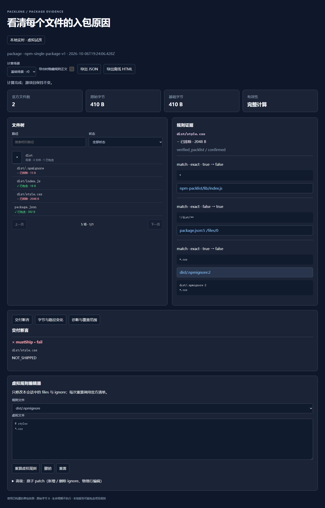

# PackLens

[English](README.md)

**PackLens 是本地 npm 入包原因解释器，核对官方清单，展示规则证据，支持虚拟试改、交付断言，也能为选定文件检查原始字节预算。**

Explain npm package contents locally, trace rule evidence, try virtual edits, and check shipping assertions and raw-byte budgets.

## 找回漏掉的 CSS

合成 CSS 样例中的 `dist/style.css` 恰好为 2,048 B，被 `dist/.npmignore:2` 的 `*.css` 排除。在虚拟编辑器中删除这一行并重算：

| 计算场景 | CSS | mustShip | 入包原始字节 |
| --- | --- | --- | --- |
| 基础场景 | 已排除 | fail | 410 B |
| 删除物理第 2 行 | 已包含 | pass | 2,458 B |

净增 2,048 B。修改 `files` 还可能改变保留的 package.json 字节，报告会单独列出。



## 构建与运行

使用 **Node 24.15.0**：

```sh
npm ci --ignore-scripts
npm run build
node dist/cli.js demo css-missing --html ../css-demo.html
node dist/cli.js serve fixtures/css-missing/package --intent fixtures/css-missing/intent.json
```

打开命令输出的 `http://127.0.0.1:<port>/`。选择 `dist/.npmignore`，删去 `*.css`，点击“重算虚拟规则”。撤销、重置、高级原子 patch 和导出均在当前会话内运行，源项目保持不变。默认中文，`--locale en` 切换英文。

导出的 HTML 从磁盘打开即可查看已完整计算的基础与试改场景，包括搜索、状态筛选、目录折叠、来源定位、交付断言和精确差异。新的规则试改由 live 模式中的 Node 官方清单计算。字体、脚本和样式均保存在本地。

生成并在独立目录安装本地分发包：

```sh
npm pack --ignore-scripts
# 在另一个目录执行：
npm install --omit=dev --ignore-scripts /path/to/packlens-0.1.0.tgz
./node_modules/.bin/packlens demo css-missing --html css-demo.html
```

Windows 使用 `node_modules\.bin\packlens.cmd`。分发包包含六套受控演示资产和固定 profile 依赖的精确版本声明。目前提供源码与本地 tarball 分发。

## 常用命令

```sh
node dist/cli.js analyze ./your-built-package --intent ./intent.json --json
node dist/cli.js analyze ./your-built-package --html ../report.html
node dist/cli.js explain ./your-built-package dist/style.css
node dist/cli.js simulate ./your-built-package --patch ./patch.json --intent ./intent.json --html ../comparison.html
node dist/cli.js serve ./your-built-package --intent ./intent.json --port 0
node dist/cli.js demo nested-ignore --html ../nested.html
node dist/cli.js --version
```

默认自动分配端口（也可显式传入 `--port 0`）会跳过浏览器禁用的端口。显式指定 `6666` 等禁用端口时返回 `BROWSER_RESTRICTED_PORT`；自动分配连续命中禁用端口时，会释放监听并返回 `BROWSER_PORT_UNAVAILABLE`。

输出文件放在分析根目录之外，覆盖文件需显式添加 `--overwrite`。`--output-json <path>` 保存公开 JSON；`--strict-explanations` 要求解释覆盖；`--locale zh-CN|en` 选择语言。可选 `serve --open` 使用 Windows 默认浏览器，其他平台对该选项返回 `OPEN_UNSUPPORTED`。

退出码：`0` 完整且通过，`1` 确定断言失败，`2` 未知/未覆盖/过时/超限或严格解释失败，`3` 输入或运行错误。优先级为 `3 > 2 > 1 > 0`。`forced-include` 试改后仍有预期断言失败，因此 demo 返回 `1`。

## 交付意图与规则试改

```json
{"schemaVersion":1,"mustShip":["dist/style.css","templates/**/*.html"],"mustNotShip":["tests/**"],"sizeBudget":{"maxRawBytes":"1048576","include":["dist/**"],"exclude":["**/*.map"]}}
```

mustShip 要求全部已有匹配项入包，零匹配失败；mustNotShip 要求没有入包匹配项。预算使用精确整数原始字节，等于上限通过。意图匹配器支持字面路径、`*`、`**`、`?`，与 npm `files` 的匹配语义分别定义。

示例统计 `dist/` 下已入包文件的字节数，同时从预算中排除 source map。省略 `include` 时从整个包开始筛选。`exclude` 优先于所有包含项，仅影响预算。JSON 结果中的 `matchedExistingPaths` 列出预算范围内本地存在的文件，`matchedShippedPaths` 列出实际入包的文件。总字节数只统计后者。

```json
{"schemaVersion":1,"operations":[{"op":"removeIgnoreLine","path":"dist/.npmignore","line":2,"expected":"*.css"}]}
```

支持 `replaceFiles`、`removeIgnoreLine`、`replaceIgnoreLine`、`appendIgnoreLine`、`replaceIgnoreText`、`createIgnore`、`deleteIgnore`。批量操作针对当前 revision 的原始物理行原子执行。高级编辑器接受完整 patch JSON。每次正式试改调用官方清单；revision 单调增加，计算失败保留上次有效场景。

## 六个可复现样例

| 名称 | 核验重点 |
| --- | --- |
| nested-ignore | 子规则修复只影响自己的作用域；保留祖先阻断证据 |
| empty-glob | 修正 distt/** 后真实文件进入，零匹配警告消失 |
| css-missing | 删除物理第 2 行，2,048 B 样式进入 |
| template-missing | files 加入 templates，根 ignore 保持失活 |
| unexpected-growth | 恢复 files 为 dist，草稿与测试资源排除，408 B 预算边界通过 |
| forced-include | metadata 与 main/bin 强制项仍在，删除无效 ignore 不会修复 mustNotShip |

[fixtures](fixtures/) 包含实体 package、意图、patch、固定预期清单与复制即用命令。每个基础/试改都比较影子官方清单、记录 walker、实体官方清单及 npm 12.2.0 CLI 四方集合；生命周期哨兵验证脚本没有执行。

## API 与兼容范围

开发检查依次运行 `npm ci --ignore-scripts --no-audit --no-fund`、`npm run build`、`npx --no-install playwright install chromium` 和 `npm test`。Chromium 安装必须匹配锁定的 Playwright 版本。浏览器启动失败时，测试仍会关闭本地服务器并清理临时目录，使缺少浏览器的问题正常报错并退出。

通过 `snapshotPackage`、`createScenarioSession`、`session.apply/undo/reset` 管理场景；`toPublicReport(report,{omitRuleText:true})` 导出公开数据；`renderHtml(baseline,{scenarios:[patched],omitRuleText:true})` 生成离线页。[英文 API 示例](README.md#api)可直接使用。

`servePackage(dir,options)` 返回实际 loopback 地址、端口和异步 close。API 使用临时内存凭据、精确 Host、来源和 revision 检查，JSON 请求最大 1 MiB。导出移除 live 凭据；服务器导出保留基础场景与最近 20 个成功场景。

固定配置 `npm-single-package-v1`：Node 24.15.0、npm-packlist 11.3.0、ignore-walk 9.0.0、Arborist 10.0.3，配合锁定传递依赖与来源摘要。npm 12.2.0 是开发对照，在运行时可缺省。清单有效性和解释置信度分别显示，未覆盖场景保留 unknown 断言。

当前实测为 Windows 引擎、CLI 与 Chromium 浏览器；Windows/Linux CI 已配置，远端 CI 及 Linux/macOS 执行尚无记录。集中支持说明见 [SUPPORT](SUPPORT.md)，贡献方法见 [CONTRIBUTING](CONTRIBUTING.md)，第三方许可见 [THIRD_PARTY_NOTICES](THIRD_PARTY_NOTICES.md)。包作者访谈尚未实施，采用率与省时收益仍待研究。

原创代码、合成样例与截图采用 [MIT](LICENSE) 许可。
运行依赖由 npm 另行安装；PackLens 分发原创 MIT 代码与合成素材，不复制或捆绑依赖代码。本次源码及不捆绑 tar 的分发审计完成；`@npmcli/agent@5.0.2`（ISC）与 `proxy-agent-negotiate@1.1.0`（MIT）的独立许可正文仍未取得，notice 保留精确元数据、公开归属及查询证据。实际复制的第三方文本/资产保留完整可得授权原文及来源。未来捆绑依赖必须重新审查。

`analyzeSnapshot(snapshot, options)`、`simulate(snapshot, patch, intent, options)`、`createScenarioSession(snapshot, intent, options)` 及 `session.apply(patch, options)` / `undo(revision, options)` / `reset(revision, options)` 接受可选 `options.signal`。取消以 `AbortError` / `CANCELLED` 拒绝，等待 Worker 退出和影子目录清理，保留上次已提交场景；初始化 signal 不影响后续操作。HTTP 未完成响应断开会取消本请求工作；幂等 `close()` 取消活动及排队工作。

单次 CLI 模拟及其 HTML 输出路径共享 30 秒请求预算；交互操作各自获得新期限。每份 `files` 列表最多展开 50,000 分支、累计 1,048,576 UTF-8 字节；超限或无法证明完整的 brace 输入返回 `LIMIT_EXCEEDED`。具体支持形式与恢复方法见 [SUPPORT](SUPPORT.md)。

`CLEANUP_FAILED` 用安全 UUID `cleanupId` 标识尚未清理的私有副本。释放文件占用后重试操作，或在同一进程调用 `retryCleanup(cleanupId)` / `retryPendingCleanup()`；下一次分析会先重试旧对象，再创建新副本。进程退出后，在系统临时目录检查精确名称 `packlens-shadow-<cleanupId>`，确认是工具副本后手工移除。ID 只查找进程内的真实创建记录；公共报告不包含绝对清理路径。
